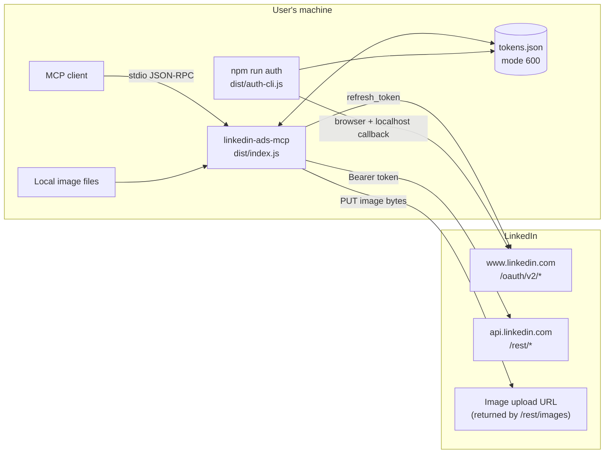
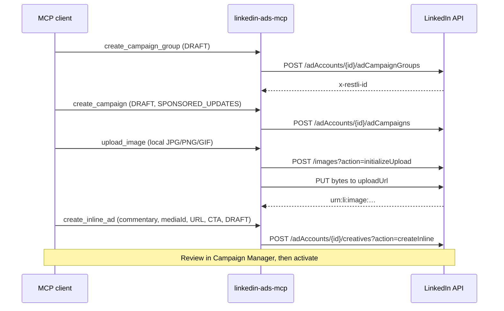

<!--
Date written: 2026-11-24
Written By Bill Roth
Generated by Claude
Contributed under this project's MIT License (see LICENSE).
-->

# Architecture

This document explains how the LinkedIn Ads MCP server is built: what runs
where, how a tool call becomes a LinkedIn API request, how authentication
works, and which safety rules apply to tools that change data. It is meant for
contributors and for anyone deciding whether to connect the server to real ad
accounts. For installation and usage, see the [README](README.md).

## 1. Overview

The server is a local [Model Context Protocol](https://modelcontextprotocol.io)
server written in TypeScript for Node.js 18+. An MCP client (Claude Desktop,
Claude Code, Cursor and others) starts it as a child process and talks to it
over **stdio** using JSON-RPC. The server exposes 25 tools and turns each tool
call into one or more calls to LinkedIn's versioned Marketing REST API.

It has no database, no web UI and no background jobs. The only state it keeps
is the OAuth token file. Its only network connections are to LinkedIn.



## 2. Source layout

```
src/
├── index.ts                  MCP server: tool registry + dispatch switch
├── auth-cli.ts               `npm run auth`: one-time browser sign-in
├── auth/
│   ├── oauth.ts              Authorization-code flow (express callback server)
│   └── token-store.ts        Reads/writes tokens.json, auto-refreshes tokens
├── lib/
│   ├── linkedin-api.ts       LinkedInApiClient: every HTTP call to LinkedIn
│   └── types.ts              Request/response and tool-input types
├── tools/                    One file per tool family (schema + handler)
│   ├── accounts.ts
│   ├── performance.ts
│   ├── demographics.ts
│   ├── conversions.ts
│   ├── analytics.ts
│   └── campaign-management.ts   all write tools + list_campaigns + upload_image
└── scripts/                  Stand-alone CLIs, not used by the MCP server
    ├── list_performance.ts
    └── generate-dashboard.ts    builds a local dashboard.html (loads Chart.js from jsDelivr)
```

`npm run build` runs `tsc`, which compiles `src/` to `dist/`. MCP clients run
`dist/index.js`, so **source changes take effect only after a rebuild and a
client restart.**

Runtime dependencies: `@modelcontextprotocol/sdk`, `express` (only for the
OAuth callback), `open` (opens the browser during sign-in) and `dotenv`.

## 3. Layers

The code has three layers, and each one only talks to the layer below it.

| Layer | File(s) | Responsibility |
|---|---|---|
| **Protocol** | `index.ts` | Registers the `TOOLS` array for `tools/list`. On `tools/call` it checks that a valid token exists, dispatches through a `switch` on the tool name, and wraps the result (or error) as MCP text content containing JSON. |
| **Tools** | `tools/*.ts` | Each tool is a pair: a `Tool` object (name, description, JSON Schema for its input) and a `handleX(client, args)` function. Handlers validate required fields, apply defaults (for example `DRAFT` status), build the LinkedIn request body, call the API client and return a compact JSON result. |
| **API client** | `lib/linkedin-api.ts` | `LinkedInApiClient` owns URL building, Rest.li encoding, headers, retries, rate-limit handling, pagination and error mapping. Apart from the token refresh in `token-store.ts`, it is the only code that calls LinkedIn's REST API. |

### Adding a tool

1. Add the `Tool` definition and `handleX` function to the right `tools/*.ts` file.
2. If it needs a new endpoint, add a method to `LinkedInApiClient`.
3. Import both into `index.ts`, add the `Tool` to `TOOLS` and add a `case` to the dispatch `switch`.
4. Run `npm run build` and restart the MCP client.

## 4. Request pipeline

Every LinkedIn call goes through the private `LinkedInApiClient.request()`:

1. **Token:** `TokenStore.getAccessToken()` returns the access token, refreshing it first if it expires within 5 minutes. If no token exists, the call fails with "Not authenticated. Please run: npm run auth".
2. **URL:** `https://api.linkedin.com` + endpoint. Query parameters use Rest.li 2.0 encoding: arrays become `List(a,b)`, and `fields` and `dateRange` are passed through without encoding so their structure survives.
3. **Headers:** `Authorization: Bearer …`, `LinkedIn-Version` (the `LINKEDIN_VERSION` constant), `X-Restli-Protocol-Version: 2.0.0`, plus `X-RestLi-Method` (for example `PARTIAL_UPDATE`) when the call sets one.
4. **Send and handle the response:**
   - `429` waits for `Retry-After` (or uses exponential backoff), then retries. This applies to every request, because LinkedIn rejects rate-limited requests before doing any work.
   - Other non-2xx responses become an `Error("LinkedIn API error (status): message")`. 4xx errors are marked non-retryable.
   - `201`/`204`/empty responses return `{ id }` taken from the `x-restli-id` header. This is how create calls report the new object's ID.
   - Everything else is parsed as JSON.
5. **Retry policy:** up to 3 attempts with exponential backoff, **for reads only**. A request counts as a read when it uses `GET` and has no write `X-RestLi-Method`; see `isReadRequest()`. Creates, updates and deletes are never retried, because the first attempt may have succeeded even though its response was lost, and a retry would create a duplicate campaign or ad. Authentication errors and 4xx errors are never retried.

### LinkedIn endpoints used

| Endpoint | Used for |
|---|---|
| `/rest/adAccounts`, `/rest/adAccounts/{id}` | Account list and details |
| `/rest/adAccounts/{id}/adCampaignGroups[/{id}]` | List, create, update and delete campaign groups |
| `/rest/adAccounts/{id}/adCampaigns[/{id}]` | List, create, update and delete campaigns |
| `/rest/adAccounts/{id}/creatives[/{id}]` | List and update creatives; `?action=createInline` creates a post and its creative in one call |
| `/rest/adAnalytics` | All performance, demographic, reach, conversion and lead-gen metrics |
| `/rest/posts/{urn}`, `/rest/images/{urn}` | Resolve a creative's text and image for reporting |
| `/rest/images?action=initializeUpload` | Start an image upload |
| `/rest/conversions`, `/rest/leadForms`, `/rest/dmpSegments` | Conversion rules, lead forms, saved audiences |

The API version is pinned in `LINKEDIN_VERSION`. LinkedIn supports each
monthly version for about a year, so the constant needs a periodic bump and a
re-test.

## 5. Authentication

### One-time sign-in (`auth-cli.ts` → `auth/oauth.ts`)

1. Reads `LINKEDIN_CLIENT_ID`, `LINKEDIN_CLIENT_SECRET` and `LINKEDIN_REDIRECT_URI` (default `http://localhost:3000/callback`).
2. Starts a temporary express server on the redirect URI's port, generates a random `state` value, and opens the LinkedIn authorization URL in the browser.
3. Requested scopes: `rw_ads`, `r_ads_reporting`, `r_organization_social` and `w_organization_social`.
4. On `/callback` it checks `state` to block forged callbacks, exchanges the code for tokens at `/oauth/v2/accessToken`, saves them and shuts the server down. The flow times out after 5 minutes.

The redirect URI must be listed **exactly** (scheme, host, port, path, no
trailing slash) under *Authorized redirect URLs* on the LinkedIn app's Auth
tab. Otherwise LinkedIn stops at "The redirect_uri does not match the
registered value".

### Token storage and refresh (`auth/token-store.ts`)

- The file location is `TOKEN_STORAGE_PATH`, or `~/.linkedin-ads-mcp/tokens.json` when that isn't set. The directory is created with mode `0700` and the file is written with `0600`.
- It stores `access_token` (about 60 days), `refresh_token` (about 365 days), `expires_in` and a computed `expires_at`.
- When fewer than 5 minutes remain on the access token, it is refreshed with `grant_type=refresh_token` and the file is rewritten. The refresh needs `LINKEDIN_CLIENT_ID` and `LINKEDIN_CLIENT_SECRET` in the **MCP server's** environment, not only during `npm run auth`. When the refresh token itself expires, run `npm run auth` again.

### Environment variables

| Variable | Required | Purpose |
|---|---|---|
| `LINKEDIN_CLIENT_ID` | Yes | LinkedIn app client ID (sign-in and token refresh) |
| `LINKEDIN_CLIENT_SECRET` | Yes | LinkedIn app client secret (sign-in and token refresh) |
| `LINKEDIN_REDIRECT_URI` | No | OAuth callback; default `http://localhost:3000/callback` |
| `TOKEN_STORAGE_PATH` | No | Token file location; default `~/.linkedin-ads-mcp/tokens.json` |

`index.ts` and `auth-cli.ts` load `dotenv/config`, which reads `.env` from the
**current working directory**. That works for `npm run auth` run from the repo,
but an MCP client usually launches the server from another directory. Set the
variables in the client's MCP config `env` block (as the README shows), or
launch with `node --env-file=/path/to/file dist/index.js`.

### Multiple advertisers

One LinkedIn login reaches every ad account the member has a role on
(Account Manager or Campaign Manager). Each tool takes an `accountId`, so a
single server instance can manage many advertisers. A second LinkedIn *login*
needs its own token file, which means a second server entry with a different
`TOKEN_STORAGE_PATH`.

Note LinkedIn's access tiers: an app on the Advertising API's Development tier
can read any number of ad accounts but make changes in only five. Making
changes in more needs the Standard tier.

## 6. Tool catalog

**Read (15):** `list_ad_accounts`, `get_account_details`,
`get_campaign_performance`, `get_creative_performance`, `get_campaign_groups`,
`get_audience_demographics`, `get_audience_reach`, `list_saved_audiences`,
`get_conversion_performance`, `list_conversions`, `get_lead_gen_performance`,
`list_lead_forms`, `compare_performance`, `get_daily_trends` and
`list_campaigns`. Unlike the performance tools, `list_campaigns` also returns
drafts and campaigns with no impressions.

**Write (10):**

| Tool | Default / behavior |
|---|---|
| `create_campaign_group` | `status` defaults to `DRAFT` |
| `create_campaign` | `DRAFT`, type `SPONSORED_UPDATES`, `CPM`, locale US/en, Audience Network **off**, audience expansion **off**, `NOT_POLITICAL` |
| `create_creative` | Sponsors an existing post URN; `intendedStatus` defaults to `DRAFT` |
| `create_inline_ad` | Creates a sponsored-content post (tagged with `adContext.dscAdAccount`) and its creative in one call; `DRAFT` |
| `upload_image` | Two steps: `initializeUpload`, then PUT the local file's bytes to the returned URL. Returns the `urn:li:image:…` to pass as `mediaId` |
| `update_campaign_group`, `update_campaign`, `update_creative_status` | Partial updates; **can set `ACTIVE`** |
| `delete_campaign_group`, `delete_campaign` | Drafts are deleted outright; other statuses go to `PENDING_DELETION` |

### Typical ad build



## 7. Safety model

- **Draft defaults:** every create tool defaults to `DRAFT`. A campaign, group
  or ad goes live only when `ACTIVE` is passed on purpose or it is activated
  later.
- **No write retries:** a failed create is reported, not repeated, so a lost
  response can't produce duplicates.
- **Recommended: client-side approval.** Five tools can activate or delete:
  `update_campaign`, `update_campaign_group`, `update_creative_status`,
  `delete_campaign` and `delete_campaign_group`. Most MCP clients can require
  approval before specific tools run. In Claude Code, for example, add them to
  `permissions.ask` in `settings.json` as
  `mcp__<server-name>__update_campaign` and so on, where `<server-name>` is the
  name you gave the server in your MCP config. Creates can then run freely
  while anything that spends money or deletes still needs a person's OK.

LinkedIn's own ad review (usually under 24 hours) still applies after activation.

## 8. Known limitations

- `create_inline_ad` has no field for image alt text.
- `mediaTitle` maps to the post's media title. It hasn't been confirmed whether it appears as a single-image ad's headline.
- Updates default to USD when no currency is given.
- `delete_campaign_group` finds the group's status by listing groups, which may miss a group on a later page of a very large account.
- There's no targeting-search tool: targeting must be passed as raw `targetingCriteria` URNs, and there is no audience-size estimate before a campaign is created.
- The OAuth error page shows LinkedIn's `error_description` without HTML escaping. It is served only on localhost during sign-in.
